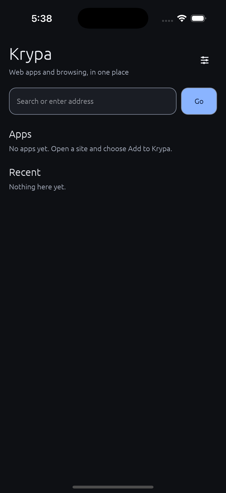

# iOS status (2026-11-15)

First code on Apple platforms. Evidence: GitHub Actions, macOS 15 runner (Xcode 16.4 default), iOS 18.x Simulator, no physical device. Nothing here is verified on a device.

## What works (proven by CI run 43741085386)

- The whole workspace formats, lints (clippy `-D warnings`) and passes its tests on macOS, and the platform-neutral crates build for `aarch64-apple-ios-sim` and `aarch64-apple-ios` (SQLite bundled builds fine for iOS).
- `crates/krypa-ios` (C ABI static library) and `apps/ios` (Swift/UIKit shell, XcodeGen) build, boot in the Simulator and draw the real `krypa-ui` launcher through wgpu/Metal. The CI job fails if the app is not alive 10 s after launch or the Rust side logs a failure.
- Design: [ADR-0002](adr/0002-ios-shell-c-abi.md).

## Corrections to the Phase 0 documents (CI showed otherwise)

- wgpu 30.0.2 `request_device` with default limits **fails on the Simulator** (`max_inter_stage_shader_variables` 15 < 16). Krypa requests the adapter's own limits.
- `RequestAdapterOptions` has a new field `apply_limit_buckets`; `TexturesDelta` must be consumed or egui panics on drop. `CurrentSurfaceTexture`, `Queue::present` and `InstanceDescriptor::new_without_display_handle` are as the docs said.
- A Rust staticlib does not carry its framework dependencies into Xcode: the app links `Metal`, `QuartzCore`, `CoreGraphics`, `Foundation`, `UIKit` and `libc++` by hand (`apps/ios/project.yml`). That list linked successfully.
- `CAMetalLayer` pointer to `create_surface_unsafe(CoreAnimationLayer)` works; no raw-window-handle or winit.
- Panic policy changed from "undecided" to catch-and-poison (ADR-0002).

## Not done (next steps, in order)

1. WKWebView in the shell plus the real engine adapter (EngineCommand/EngineEvent over the ABI; UniFFI vs more C ABI, see ADR-0002 point 2).
2. Software keyboard / text input (`UITextInput`) so the address field is usable; taps are forwarded but untested end to end (no tap tool on the runner and XCUITest cannot see egui widgets without the accessibility bridge).
3. Storage location on device, navigation, accessibility (AccessKit), dark/light system theme, scene lifecycle and background/foreground surface handling, physical-device run (needs signing: owner decision).

Known issue: the display link sleeps when idle but the full-screen layer is opaque and redraws on every touch move; battery has not been measured.
